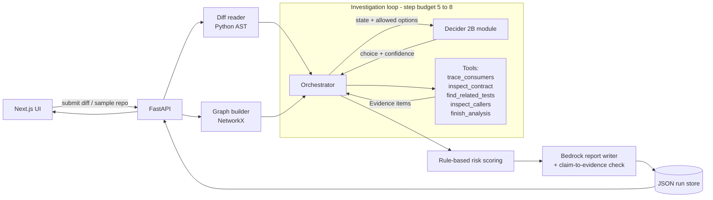

# Architecture

## Components
| Component | Responsibility | Never does |
| --- | --- | --- |
| Diff reader | Structured Change object | Judge impact |
| Graph builder | Real dependency edges with file and line | Guess edges |
| Decider 2B | Choose next tool + confidence | Run tools, score risk |
| Tools | Gather Evidence (path, lines, excerpt) | Decide what runs next |
| Risk scoring | Deterministic score from documented factors | Use an LLM |
| Bedrock | Explain evidence in prose | Invent facts or scores |

## Data shapes
`Change`, `Evidence`, `Finding`, `DecisionStep`, `Report` (Pydantic, from Part 1).
A run is stored as one JSON file containing the change, graph, decision trace, findings and report.
